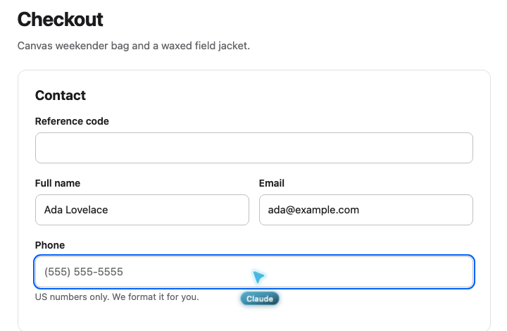

<p align="center">
  
</p>

<h1 align="center">FowlBrowser</h1>

<p align="center">Let your AI agents use your real Chrome, in background tabs, without getting in your way.</p>

---

FowlBrowser connects Claude Code (or any MCP client) to the browser you already use, with your logins, cookies and
open tabs. Agents work in their own background tabs, several at once, while you keep working. When you want to watch,
open an agent's tab and a cursor shows you exactly where it clicks.

<p align="center">
  
</p>

- **Your real browser.** Your accounts just work: Gmail, GitHub, Google Docs, YouTube, X. No separate profile to sign in to.
- **Never in your way.** Agent tabs open in the background, muted, in a collapsed tab group. Nothing steals focus.
- **Many agents at once.** Every tab belongs to one session, so separate agents never touch each other's tabs (subagents
  share their session's tabs).
- **A cursor you can follow.** In the tab you're looking at, an animated cursor travels to every click and labels the agent.
- **Cleans up after itself.** When an agent finishes its turn, its work tabs close. Tabs it opened for you stay.
- **No prompts or bars.** No "Allow remote debugging?" dialog, and no debugging bar with one launch flag.
- **Built for agents.** Compact page snapshots with element refs, changes-only results, and fast errors that say why
  (for example, "covered by the cookie banner, dismiss it first").

## Requirements

- macOS
- Node.js 22 or newer
- Google Chrome or [Helium](https://helium.computer). Chromium, Brave, Edge, Arc and Vivaldi are registered too but
  less tested.
- [Claude Code](https://claude.com/claude-code), or any client that speaks MCP

## Install

```sh
git clone https://github.com/argofowl/FowlBrowser.git
cd FowlBrowser
sh install.sh
```

The installer copies FowlBrowser to `~/Library/Application Support/FowlBrowser`, registers the browser helper and,
when Claude Code is installed, the `fowlbrowser` MCP server and its end-of-turn hook. It prints exactly what it
changed.

Then, once in each browser:

1. Open the extensions page (`chrome://extensions`).
2. Turn on **Developer mode**.
3. Click **Load unpacked** and pick `~/Library/Application Support/FowlBrowser/extension` (the installer puts this path
   on your clipboard; in the file picker, Cmd-Shift-G and paste).
4. Open the extension's **Details** and turn on **Allow access to file URLs** (needed for file uploads).

Optional: hide Chrome's "started debugging this browser" bar by relaunching it with a flag. Quit Chrome first, then:

```sh
open -a "Google Chrome" --args --silent-debugger-extension-api --restore-last-session
```

To update, pull and run `sh install.sh` again. To remove everything, run `sh uninstall.sh`.

## Use

Ask your agent in plain words. It picks the browser you name, or the one where you're signed in.

> Open my GitHub notifications in Chrome and summarize what needs a reply.

> Find the RSVP form in my email, fill it in with my details and stop before sending.

> Open YouTube in Helium, play my Watch Later list muted and leave the tab for me.

Other MCP clients can start the server with `~/Library/Application Support/FowlBrowser/mcp/bin/fowlbrowser-mcp`.
End-of-turn cleanup uses Claude Code hooks; elsewhere, agent tabs close when the session ends.

## How it works

```
Agent ── MCP ──> FowlBrowser server (one per session)
                   └─ local socket, token-gated ──> helper started by the browser
                                                       └─ native messaging ──> extension (chrome.debugger, chrome.tabs)
```

The extension drives only the tabs a session opened or was given, through `chrome.debugger`, so the browser never
opens a remote-debugging port. Everything stays on your Mac.

## Tools

| Area | Tools |
| --- | --- |
| Browsers and tabs | `browser_list`, `tab_list`, `tab_open`, `tab_claim`, `tab_release`, `tab_close`, `tab_keep`, `tab_mute`, `tab_focus` |
| Reading | `snapshot`, `screenshot`, `evaluate`, `console`, `network`, `wait_for` |
| Acting | `navigate`, `click`, `hover`, `type`, `fill_form`, `select_option`, `press_key`, `scroll`, `drag`, `upload_files`, `dialog`, `media` |
| Files and data | `download`, `downloads`, `export` (YouTube transcripts, Google Docs, Sheets and Slides), `browser_data` (history, bookmarks, recently closed, top sites; read only) |

A tab meant for you to keep is opened with `tab_open` and `for_user: true`. Your own tabs are never closed unless you
ask, and a tab an agent claimed goes back to you when it is done.

## Development

```sh
npm ci --prefix mcp && npm install --prefix test   # once
node --test extension/test/ mcp/test/ tools/test/ test/forms/test/
node tools/fake-extension.mjs --test
```

- `node test/run.mjs --browser both` runs the end-to-end scenarios against a local test site in real browsers.
- `node tools/rounds.mjs` runs a round of real Claude agents at once (half in Helium, half in Chrome) and grades each
  run: the answer, whether the cursor was on target at every click, focus steals, sound, tabs left behind, time, tool
  calls and tokens. `report.html` shows a frame of the cursor at every click. Bring your own tasks with
  `--tasks <file>`.
- `node tools/rounds.mjs --tasks tools/agents/forms.json --serve "node test/forms/server.mjs"` puts 12 agents on six
  tricky forms (custom dropdowns, a virtualized list, a cross-origin card field, closed shadow DOM, drag to reorder)
  and checks every field and any mix-up between agents.

The full contract is in [SPEC.md](SPEC.md), the cursor in [docs/cursor-spec.md](docs/cursor-spec.md).

## License

MIT, see [LICENSE](LICENSE). Includes code adapted from Playwright and a cursor based on Cua, see
[THIRD_PARTY_NOTICES.md](THIRD_PARTY_NOTICES.md).

Made by [Fowl Labs](https://fowllabs.com).
